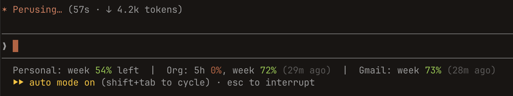

# Usage line

A Claude Code status line that shows how much usage you have left, on every Claude account you use.



- The first part is the account this window is on: what's left of the 5-hour limit, when it resets, and what's left of the weekly limit.
- After it come your other accounts, with how long ago each was last seen.
- Green means 50% or more left, yellow 20 to 49%, red under 20%.

If you switch accounts when one runs low, you can see where to go without checking each one.

## Quick start with Claude Code

1. `/plugin marketplace add bestbrian/claude-usage-line`
2. `/plugin install usage-line@claude-usage-line`
3. Tell Claude: "set up the usage line"

Claude asks whether you use one login folder or one per account. It shows you what will change, then installs. The line appears after your next reply.

## Make it yours

Ask Claude to "label my accounts in the usage line". It reads each account's org name and writes short labels, like Work and Personal. If you use cmux, each label can carry a color, and cmux tints the workspace to match the account it's on.

## Good to know

- Works on macOS and Linux with Python 3.9 or newer. No packages to install.
- Numbers show only for Claude subscription logins (Pro, Max, Team, Enterprise), not API keys.
- Another account's numbers update only when a window on that account replies. The age in brackets tells you how fresh they are.
- If you already have a status line, the installer leaves it alone unless you say to replace it. Every file it changes is backed up first.

## What it reads, and what it doesn't

- **Reads:** the usage numbers Claude Code already hands every status line (percent used and reset times), and the account's org name and id from `claude auth status --json`.
- **Writes:** small JSON files in `~/.claude/statusline/`, plus a backup of `settings.json` when you install.
- **Never:** the script never reads your login tokens, the Keychain or credential files, and makes no network calls of its own. Your usage numbers stay on your machine.

## Without the plugin

```bash
git clone https://github.com/bestbrian/claude-usage-line
python3 claude-usage-line/skills/usage-line/scripts/install.py
```

Remove it with `python3 claude-usage-line/skills/usage-line/scripts/uninstall.py`.

## Tests

```bash
cd skills/usage-line/scripts && python3 -m unittest test_usage_line
```
